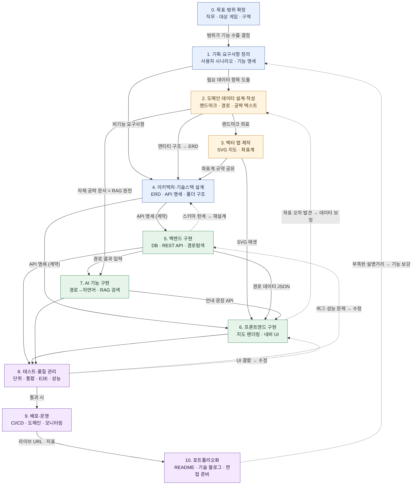

# 게임 통합 서비스 — 필요 역량 로드맵

> **프로젝트 목적**: 취업 포트폴리오. "웹서비스를 직접 설계·구현·배포한 경험"을 증명하는 것
> **핵심 기능 (권고 설계)**: 한 게임의 한 구역(예: 엘든링 DLC)에서 **랜드마크 그래프 기반 길찾기 내비게이션**
> **보조 기능 (선택)**: 챌린지 랭킹 (Speedrun.com API 연동)
> **기준 스택 (예시)**: TypeScript · Next.js(React) · Node.js · PostgreSQL · Docker · GitHub Actions · Vercel/AWS
> 목표 직무가 정해지면 해당 영역의 역량을 **[핵심]**에서 더 깊이 판다.

---

## 1. 전체 절차 순서도

**범례**
- 실선 화살표: 선행 → 후행 (산출물이 다음 단계의 입력이 됨). 화살표 위 글자는 넘겨주는 산출물
- 점선 화살표: 피드백 루프 (뒤 단계에서 문제를 발견해 앞 단계로 되돌아감)
- 색상: 파랑 = 기획·설계 / 노랑 = 데이터·콘텐츠 / 초록 = 구현 / 보라 = 검증·출시
- **S5·S6·S7은 S4의 API 명세가 확정되면 병렬로 진행할 수 있음** (명세를 계약으로 삼고 Mock 데이터로 프론트엔드를 먼저 개발)

---

## 2. 단계별 필요 역량

> 표기: **[핵심]** = 이 프로젝트의 차별점과 직결, 면접에서 설명할 거리 / **[기반]** = 없으면 진행 불가 / **[선택]** = 있으면 완성도 상승

### 0. 목표·범위 확정

| 역량 | 등급 | 프로젝트에서 맡는 역할 |
|---|---|---|
| 채용 공고 분석: 목표 직무(FE/BE/풀스택)의 요구 기술 키워드 추출 | 기반 | 어떤 기술을 깊게 팔지 정하는 기준. 기술 스택 선택(S4)의 근거가 됨 |
| 범위 관리: MVP(최소 기능 제품) 정의와 기능 우선순위 결정(MoSCoW) | 기반 | "한 게임 한 구역, 랜드마크 30~50개"로 범위를 고정해 미완성 위험을 막음 |
| 저작권 기초: 사실 정보와 표현의 구분 (대법원 97마330), 2차적저작물 개념 | 기반 | 무엇을 직접 작성하고 무엇을 쓰면 안 되는지 결정 (크롤링 배제, 맵 직접 제작) |

**다른 단계와의 관계** → S1 전체 기능 목록의 상한선을 정함 / S4 기술 스택 선택의 기준

---

### 1. 기획·요구사항 정의

| 역량 | 등급 | 프로젝트에서 맡는 역할 |
|---|---|---|
| 유저 스토리 작성 ("게이머로서 ~하고 싶다, 그래서 ~") | 기반 | "미드라까지 가는 길" 같은 시나리오를 기능 단위로 쪼갬 |
| 기능 명세서 작성: 입력·출력·예외 케이스 정의 | 기반 | "출발지 미선택 시", "경로 없음 시" 등의 동작을 미리 정해 구현 중 혼선을 막음 |
| 와이어프레임 도구: Figma (프레임, 컴포넌트, Auto Layout) | 기반 | 지도 화면·경로 패널·단계별 안내 UI의 배치를 확정. S6의 설계도 |
| 비기능 요구사항 정의: 응답 시간 목표, 모바일 대응 여부, 스포일러 차단 정책 | 선택 | S4 아키텍처와 S8 성능 테스트의 합격 기준이 됨 |
| 프로젝트 관리 도구: GitHub Issues·Projects (칸반, 마일스톤) | 선택 | 작업 진척을 기록으로 남겨 면접에서 "협업 가능한 습관"을 보여줌 |

**다른 단계와의 관계** ← S0의 범위 / → S2에 필요한 데이터 항목 전달, S4에 비기능 요구사항 전달 / ⇠ S10에서 부족한 설명거리가 보이면 되돌아옴

---

### 2. 도메인 데이터 설계·작성

| 역량 | 등급 | 프로젝트에서 맡는 역할 |
|---|---|---|
| 그래프 자료구조 모델링: 노드(랜드마크)·엣지(이동 경로)·가중치(거리·위험도·소요 시간) 설계 | **핵심** | 길찾기 기능의 뼈대. 무엇을 노드로 볼지가 안내 품질을 결정 |
| 데이터 포맷 설계: JSON Schema로 랜드마크·경로 데이터 형식 정의 및 검증 | 기반 | 직접 입력한 데이터의 오타·누락을 자동으로 걸러냄. S5 DB 시딩의 입력 |
| 게임 도메인 지식: 대상 구역의 실제 동선·지형·보스 위치·조건부 경로(엘리베이터, 잠긴 문 등) 파악 | **핵심** | 실제 플레이로 검증한 정확한 데이터가 서비스의 신뢰도 자체 |
| 기술 문서 작성: 스포일러 등급을 나눈 공략 텍스트를 직접 작성 (마크다운) | 기반 | S7 RAG의 원천 문서. 직접 작성해야 저작권·AI 학습 제약에서 자유로움 |
| 스프레드시트 활용: Google Sheets/Excel로 대량 입력 후 CSV→JSON 변환 스크립트 작성 | 선택 | 랜드마크 50개·경로 100개를 효율적으로 입력하고 관리 |

**다른 단계와의 관계** ← S1의 데이터 항목 / → S3에 랜드마크 좌표 전달, S4에 엔티티 구조 전달, S7에 공략 문서 전달 / ⇠ S6에서 좌표 오차가 발견되면 보정

---

### 3. 벡터 맵 제작

| 역량 | 등급 | 프로젝트에서 맡는 역할 |
|---|---|---|
| SVG 문법: `<path>` d 속성 명령어(M, L, C, Q, Z), `<g>` 그룹, `viewBox` 좌표계 | **핵심** | 게임사 스크린샷 대신 직접 그린 지도. 저작권을 피하면서 그 자체가 기술 성과물 |
| 벡터 드로잉 도구: Figma 또는 Inkscape의 펜 도구, SVG 내보내기·최적화(SVGO) | 기반 | 지형·건물 윤곽을 그리고 웹에서 쓰기 좋은 가벼운 SVG로 변환 |
| 좌표계 변환 수학: 게임 내 좌표 ↔ SVG 좌표 간 선형 변환(스케일·이동) | **핵심** | S2 데이터의 좌표와 지도 위 위치를 정확히 일치시킴 |
| 시각 디자인 기초: 지도 범례, 색 대비(WCAG), 레이어 구분(지형 / 랜드마크 / 경로) | 선택 | 경로가 지도 위에서 한눈에 보이게 함 |

**다른 단계와의 관계** ← S2의 랜드마크 좌표 / → S4에 좌표계 규약 공유, S6에 SVG 에셋 전달

---

### 4. 아키텍처·기술스택 설계

| 역량 | 등급 | 프로젝트에서 맡는 역할 |
|---|---|---|
| 관계형 DB 모델링: ERD 작성, 정규화(1~3NF), 그래프를 테이블로 표현(인접 리스트: `nodes`, `edges` 테이블) | **핵심** | 그래프 데이터를 DB에 저장하는 구조. 면접 단골 질문 |
| REST API 설계: 리소스 명명, HTTP 메서드·상태 코드, OpenAPI(Swagger) 명세 작성 | 기반 | 프론트·백엔드가 병렬로 개발할 수 있게 하는 계약서 |
| 웹 렌더링 전략 이해: CSR / SSR / SSG 차이와 Next.js App Router의 서버 컴포넌트 | 기반 | 공략 페이지는 SSG(검색 노출·속도), 내비 화면은 CSR(상호작용)로 나누는 판단 |
| 시스템 다이어그램 작성: Mermaid 또는 draw.io로 클라이언트-서버-DB-외부 API 구성도 | 선택 | README와 면접에서 전체 구조를 한 장으로 설명 |
| 모노레포 폴더 구조 설계: 기능 단위(feature-based) 디렉터리 구성 | 선택 | 코드가 커져도 유지보수 가능한 구조임을 보여줌 |

**다른 단계와의 관계** ← S1 비기능 요구사항, S2 엔티티 구조, S3 좌표계 규약 / → S5·S6에 API 명세 전달 (병렬 개발의 시작점) / ⇠ S5에서 스키마 한계가 드러나면 재설계

---

### 5. 백엔드 구현

| 역량 | 등급 | 프로젝트에서 맡는 역할 |
|---|---|---|
| 경로탐색 알고리즘: Dijkstra, A*(유클리드 거리 휴리스틱), 우선순위 큐(이진 힙) 구현 | **핵심** | 서비스의 심장. 라이브러리 없이 직접 구현하면 가장 강력한 면접 소재 |
| 알고리즘 확장: 조건부 엣지(아이템 보유·보스 처치 여부에 따른 통행 가능) 필터링, 다중 가중치 | **핵심** | "보스를 피해서 가는 길", "엘리베이터 해금 전 경로" 같은 실제 게임 상황 반영 |
| Backend — TypeScript (제네릭, 유니온 타입, 타입 가드) | 기반 | 그래프·경로 데이터 타입을 엄격하게 정의해 런타임 오류를 줄임 |
| Backend — Node.js 런타임: 비동기 처리(Promise, async/await), 이벤트 루프 | 기반 | API 서버의 동작 원리 |
| Next.js Route Handlers 또는 Express/NestJS로 REST API 구현 | 기반 | `/api/route?from=&to=` 같은 경로 조회 엔드포인트 제공 |
| PostgreSQL: SQL(JOIN, 인덱스), 재귀 CTE(`WITH RECURSIVE`)로 그래프 조회 | 기반 | 랜드마크·경로 데이터 저장과 조회 |
| ORM: Prisma (스키마 정의, 마이그레이션, 시드 스크립트) | 기반 | S2의 JSON 데이터를 DB에 적재하고 스키마 변경 이력을 관리 |
| 캐싱: 인메모리 그래프 로딩 또는 Redis로 자주 쓰는 경로 결과 캐싱 | 선택 | 응답 시간 단축. 성능 개선 전후 수치를 포트폴리오에 기록 |
| 입력 검증: Zod로 요청 파라미터 스키마 검증 | 선택 | 잘못된 요청에 명확한 400 에러 반환 |
| 외부 API 연동: Speedrun.com REST API, 레이트 리밋(IP당 분당 100회) 준수 | 선택 | 챌린지 랭킹 기능. 라이선스 조건(크레딧, AI 학습 금지) 준수 |

**다른 단계와의 관계** ← S4의 ERD·API 명세 / → S6에 경로 데이터(JSON) 제공, S7에 경로 결과 전달, S8 테스트 대상 / ⇢ S4로 재설계 요청 가능 / ⇠ S8에서 버그 수정 요청

---

### 6. 프론트엔드 구현

| 역량 | 등급 | 프로젝트에서 맡는 역할 |
|---|---|---|
| Frontend — JavaScript 핵심: 클로저, 이벤트 위임, DOM 이벤트(pointer/wheel), 비동기 fetch | 기반 | 지도 상호작용과 API 호출의 기본 |
| Frontend — TypeScript: 컴포넌트 Props 타입, API 응답 타입 공유 | 기반 | 백엔드와 같은 타입 정의를 공유해 불일치를 컴파일 시점에 잡음 |
| React: 컴포넌트 설계, `useState`·`useEffect`·`useRef`·`useMemo`, 커스텀 훅 | 기반 | 지도·경로 패널·단계 안내를 재사용 가능한 컴포넌트로 구성 |
| React에서 SVG 직접 다루기: 경로 `<polyline>` 동적 생성, 랜드마크 클릭·호버 | **핵심** | 계산된 경로를 지도 위에 그리는 부분. 외부 지도 라이브러리 없이 구현 |
| 지도 인터랙션: 팬·줌 구현(`viewBox` 조작 또는 d3-zoom), 터치 제스처 | **핵심** | 사용자가 지도를 움직이며 탐색. 좌표 변환 수학(S3)을 실제로 적용 |
| 애니메이션: CSS `stroke-dasharray`/`stroke-dashoffset`로 경로 그리기 효과, Framer Motion | 선택 | 내비게이션처럼 경로가 순서대로 그려지는 연출. 시연 영상에서 눈에 띔 |
| 상태 관리: Zustand 또는 React Context (출발지·도착지·현재 안내 단계) | 기반 | 여러 컴포넌트가 같은 경로 상태를 공유 |
| 서버 상태 관리: TanStack Query (캐싱, 로딩·에러 상태) | 선택 | API 호출 상태를 일관되게 처리 |
| 스타일링: Tailwind CSS, 반응형(모바일 우선) 레이아웃 | 기반 | 게임하면서 휴대폰으로 보는 사용 상황에 대응 |
| 웹 접근성: 키보드로 단계 이동, ARIA 레이블, 텍스트 안내 병행 | 선택 | 지도를 못 보는 상황에서도 텍스트로 길안내. 완성도 지표 |

**다른 단계와의 관계** ← S4의 API 명세(Mock으로 선행 개발), S3의 SVG 에셋, S5의 경로 데이터, S7의 안내 문장 / → S8 테스트 대상 / ⇢ 좌표 오차 발견 시 S2로 데이터 보정 요청 / ⇠ S8에서 UI 결함 수정 요청

---

### 7. AI 기능 구현

| 역량 | 등급 | 프로젝트에서 맡는 역할 |
|---|---|---|
| 경로 → 자연어 변환 로직: 방향 계산(벡터 외적으로 좌/우 판단), 템플릿 기반 문장 생성 | **핵심** | "교회를 지나 오른쪽 절벽길로" 같은 안내문. AI 없이도 동작하는 기본 버전 |
| LLM API 활용: Claude/OpenAI SDK 호출, 시스템 프롬프트 설계, 구조화 출력(JSON) | 선택 | 템플릿 문장을 더 자연스럽게 다듬음. Notion의 GameWebServicePrompt와 연결 |
| RAG 파이프라인: 문서 청킹, 임베딩 생성, pgvector로 유사도 검색, 검색 결과를 프롬프트에 주입 | 선택 | "미켈라의 성수 어디서 얻어?" 같은 질문에 자체 작성 공략에서만 답변 |
| 스포일러 제어: 검색 범위를 사용자가 선택한 진행도까지로 제한하는 메타데이터 필터 | **핵심** | 기획서의 핵심 문제("원치 않는 스포일러")를 기술로 해결하는 부분 |
| AI 비용·안전 관리: 토큰 수 제한, 응답 캐싱, API 키를 서버 환경변수로만 관리 | 기반 | 비용 폭증과 키 유출 방지 |

**다른 단계와의 관계** ← S5의 경로 결과, S2의 자체 공략 문서 / → S6에 안내 문장 API 제공, S8 테스트 대상

---

### 8. 테스트·품질 관리

| 역량 | 등급 | 프로젝트에서 맡는 역할 |
|---|---|---|
| 단위 테스트: Vitest/Jest로 경로탐색 알고리즘 검증 (최단 경로, 경로 없음, 순환 그래프) | **핵심** | 알고리즘이 맞다는 것을 코드로 증명. 면접에서 "어떻게 검증했나"에 답함 |
| 통합 테스트: Supertest 또는 Next.js 테스트 유틸로 API + 테스트 DB 검증 | 기반 | 백엔드 엔드포인트가 실제 DB와 함께 동작하는지 확인 |
| E2E 테스트: Playwright로 "출발지 클릭 → 도착지 클릭 → 경로 표시" 시나리오 자동화 | 선택 | 사용자 흐름 전체가 깨지지 않음을 보장 |
| 성능 측정: Lighthouse(LCP, CLS), 경로 계산 시간 벤치마크 | 선택 | 개선 전후 수치를 README에 기록하는 근거 |
| 정적 분석: ESLint, Prettier, TypeScript strict 모드 | 기반 | 코드 품질을 일정하게 유지 |
| 데이터 검증 테스트: 모든 엣지가 존재하는 노드를 가리키는지, 고립 노드가 없는지 자동 검사 | 선택 | S2에서 직접 입력한 데이터의 무결성 보장 |

**다른 단계와의 관계** ← S5·S6·S7의 구현물 / → 통과 시 S9로 / ⇢ 실패 시 S5·S6으로 수정 요청 (피드백 루프)

---

### 9. 배포·운영

| 역량 | 등급 | 프로젝트에서 맡는 역할 |
|---|---|---|
| Git 협업 규칙: 브랜치 전략(GitHub Flow), Conventional Commits, PR 작성 | 기반 | 커밋 이력이 개발 과정을 보여주는 증거가 됨 |
| CI/CD: GitHub Actions 워크플로(YAML)로 린트·테스트·빌드 자동화 | 기반 | PR마다 자동 검사. "배포 경험"의 핵심 증거 |
| 컨테이너: Docker, Dockerfile 멀티 스테이지 빌드, docker-compose(앱 + PostgreSQL) | 선택 | 로컬과 서버 환경을 동일하게 맞춤 |
| 호스팅: Vercel(프론트·API) + Supabase/Neon(관리형 PostgreSQL) 또는 AWS(EC2, RDS) | 기반 | 실제로 접속 가능한 라이브 URL 확보 |
| 네트워크 기초: 도메인 구매, DNS 레코드(A, CNAME), HTTPS 인증서 | 기반 | 자체 브랜드 도메인으로 서비스 (게임명은 경로에만: `자체명.com/elden-ring`) |
| 환경변수·비밀 관리: `.env` 분리, GitHub Secrets, Vercel 환경변수 | 기반 | DB 비밀번호·AI API 키 유출 방지 |
| 모니터링: Sentry(에러 추적), Vercel Analytics 또는 Google Analytics | 선택 | 실제 사용 데이터와 오류 대응 경험을 포트폴리오에 기록 |
| 법적 고지: 비영리 팬사이트 면책 문구, Speedrun.com 데이터 출처 표기 | 기반 | 게임사 팬 활동 정책과 데이터 라이선스 조건 준수 |

**다른 단계와의 관계** ← S8 통과 / → S10에 라이브 URL과 운영 지표 제공

---

### 10. 포트폴리오화

| 역량 | 등급 | 프로젝트에서 맡는 역할 |
|---|---|---|
| 기술 문서 작성: README 구성(문제 정의 → 해결 → 아키텍처 → 기술 선택 이유 → 트러블슈팅) | **핵심** | 면접관이 가장 먼저 보는 결과물 |
| 기술 블로그 작성: "A*로 게임 내비게이션 만들기", "SVG 좌표계 변환" 같은 주제 | 선택 | 깊이 있는 이해를 글로 증명 |
| 시연 자료 제작: 화면 녹화(GIF/MP4), 아키텍처 다이어그램 | 기반 | 30초 안에 프로젝트 가치를 전달 |
| 기술 면접 대비: 알고리즘 선택 근거(Dijkstra vs A*), 시간 복잡도 O((V+E)logV), DB 설계 트레이드오프 설명 | **핵심** | 만든 것을 말로 설명하는 능력. 포트폴리오의 최종 목적 |

**다른 단계와의 관계** ← S9의 라이브 URL·지표, 모든 단계의 트러블슈팅 기록 / ⇢ 설명거리가 부족하면 S1로 돌아가 기능 보강

---

## 3. 단계 간 관계 요약

| 단계 | 받는 것 (선행 단계) | 넘기는 것 (후행 단계) | 되돌아오는 피드백 |
|---|---|---|---|
| 0. 목표·범위 | — | 기능 상한선 → S1 | — |
| 1. 기획 | 범위 ← S0 | 데이터 항목 → S2, 비기능 요구 → S4 | ← S10 (기능 보강) |
| 2. 데이터 | 데이터 항목 ← S1 | 좌표 → S3, 엔티티 → S4, 공략 문서 → S7 | ← S6 (좌표 보정) |
| 3. 맵 | 좌표 ← S2 | 좌표계 규약 → S4, SVG → S6 | — |
| 4. 설계 | ← S1, S2, S3 | API 명세 → S5, S6 | ← S5 (스키마 재설계) |
| 5. 백엔드 | 명세 ← S4 | 경로 JSON → S6, 경로 결과 → S7 | ← S8 (버그) |
| 6. 프론트엔드 | ← S3, S4, S5, S7 | 구현물 → S8 | ← S8 (UI 결함) |
| 7. AI | ← S2, S5 | 안내 문장 → S6 | — |
| 8. 테스트 | ← S5, S6, S7 | 통과 → S9 | → S5, S6로 수정 요청 |
| 9. 배포 | ← S8 | 라이브 URL → S10 | — |
| 10. 포트폴리오 | ← S9 + 전 단계 기록 | — | → S1 |

**병렬 구간**: S2(데이터)와 S3(맵)은 일부 병렬 가능 / S5·S6·S7은 S4 완료 후 병렬 개발 가능 (Mock API 활용)
**임계 경로**: S0 → S1 → S2 → S4 → S5 → S6 → S8 → S9 → S10 (이 경로가 늦어지면 전체 일정이 늦어짐)

---

## 4. 학습 우선순위 제안

1. **가장 먼저**: TypeScript + React + SVG 기초 — S3·S6 진입의 전제
2. **차별점 확보**: 그래프 자료구조 + Dijkstra/A* 직접 구현 + 단위 테스트 — 면접 핵심 소재
3. **완성 보장**: PostgreSQL/Prisma + Next.js API + Vercel 배포 + GitHub Actions — "배포 경험" 증명
4. **여유가 있을 때**: RAG·LLM, Speedrun.com 랭킹, Docker, Sentry

> 직무가 **프론트엔드**면 S3·S6의 [핵심] 역량(SVG 인터랙션, 애니메이션, 접근성)을, **백엔드**면 S5·S7의 [핵심] 역량(알고리즘, DB 설계, 캐싱, RAG)을 더 깊이 판다.
