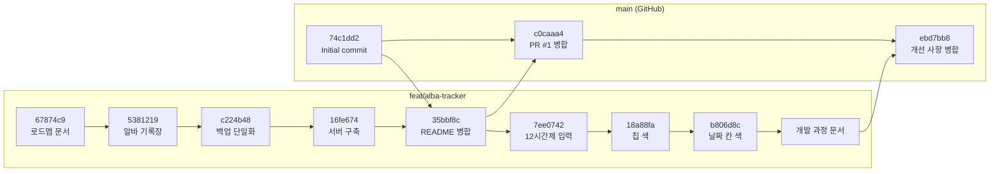

# 알바 기록장 개발 과정

> 아래 Mermaid 코드는 GitHub에서 바로 트리 그림으로 렌더링됩니다.

## 1. 진행 과정 트리

```mermaid
flowchart TD
    R["알바 기록장<br/>근무 시간 기록 + 임금 자동 계산"]

    R --> P1["1단계 · 기본 앱<br/>단일 HTML · localStorage"]
    R --> P2["2단계 · 백업 단일화<br/>폴더 고정 JSON 파일"]
    R --> P3["3단계 · 집 PC 서버<br/>Node.js · 원격 저장"]
    R --> P4["4단계 · 화면 개선<br/>시간 입력 · 달력 표시"]
    R --> P5["5단계 · GitHub 정리<br/>원격 연동 · main 병합"]

    P1 --> P1a["결정: 단일 HTML 웹앱<br/>(Node·Python 없는 환경)"]
    P1 --> P1b["달력 · 근무 기록<br/>직접 입력 + 출퇴근 버튼"]
    P1 --> P1c["근무지 여러 곳<br/>시급 · 색 · 정산 마감일"]
    P1 --> P1d["임금 계산<br/>기본급 · 주휴수당 · 야간/휴일 가산 · 휴게 차감"]
    P1 --> P1e["다크 테마 기본 · JSON 백업"]
    P1 --> P1f["?test 자체 점검<br/>임금 계산 검증"]

    P2 --> P2a["File System Access API<br/>폴더 한 번 선택 후 같은 파일 사용"]
    P2 --> P2b["backup 폴더 git 제외<br/>(개인 급여 정보 보호)"]

    P3 --> P3a["결정: 집 PC 서버 + Tailscale"]
    P3 --> P3b["server.js<br/>의존성 없는 Node 서버 · JSON 파일 저장"]
    P3 --> P3c["rev 버전 충돌 검사<br/>다른 기기 동시 수정 방지"]
    P3 --> P3d["localhost 전용 + 호스트 검사<br/>외부는 tailscale serve HTTPS"]
    P3 --> P3e["날짜별 스냅샷 백업<br/>server.test.js"]
    P3 --> P3f["폴더 백업 기능 제거<br/>(서버 파일이 원본)"]

    P4 --> P4a["시간 선택: 12시간제<br/>오전/오후 · 시 · 5분 단위 목록"]
    P4 --> P4b["달력 칩: 근무지 / 근무 시간 2줄"]
    P4 --> P4c["오늘 버튼 삭제"]
    P4 --> P4d["날짜 칸 색: 하루 근무시간<br/>기본색 → 노랑(4h) → 빨강(8h)"]
    P4 --> P4e["칩을 칸 안의 별도 상자로"]

    P5 --> P5a["origin 연결 · push"]
    P5 --> P5b["원격 README 커밋 병합"]
    P5 --> P5c["feat/alba-tracker → main 병합"]

    classDef root fill:#1d2129,stroke:#7c9cff,color:#e7e9ee
    classDef phase fill:#232838,stroke:#7c9cff,color:#e7e9ee
    class R root
    class P1,P2,P3,P4,P5 phase
```

## 2. 브랜치 흐름

## 3. 커밋 목록

| 커밋 | 날짜 | 내용 |
|---|---|---|
| 67874c9 | 11-24 | 게임 통합 서비스 역량 로드맵 문서 추가 |
| 5381219 | 11-24 | 알바 기록장 추가: 달력 근무 기록과 임금 자동 계산 |
| c224b48 | 11-25 | 백업을 고정 폴더의 alba-backup.json 하나로 단일화 |
| 16fe674 | 11-25 | 알바 tracker 서버 구축과 데이터 원격 저장 구현 |
| 74c1dd2 | 11-25 | Initial commit (GitHub에서 만든 README) |
| 35bbf8c | 11-25 | 원격 main의 README 초기 커밋 병합 |
| 7ee0742 | 11-25 | 근무 시간 입력을 12시간제·5분 단위 목록으로 바꾸고 달력 표시 개선 |
| 18a88fa | 11-25 | 달력 칩 색을 하루 근무시간에 따라 그라데이션으로 표시 |
| c0caaa4 | 11-25 | PR #1 병합 (서버 구축까지 main 반영) |
| b806d8c | 11-25 | 날짜 칸 전체를 근무시간 색으로 칠하고 칩을 별도 칸으로 표시 |
| da73fd8 | 11-25 | 개발 과정 트리 문서(HISTORY.md) 추가 |
| ebd7bb8 | 11-25 | 개선 사항 main 병합 |

## 4. 남은 일

- Tailscale 설치·로그인 후 `tailscale serve --bg 8787`
- 작업 스케줄러로 서버 자동 시작 등록, Windows 절전 해제
- `backup` 폴더를 클라우드 드라이브로 복사 (디스크 고장 대비)
- 미구현: 연장근로(일 8시간·주 40시간 초과) 가산, 세금 공제
